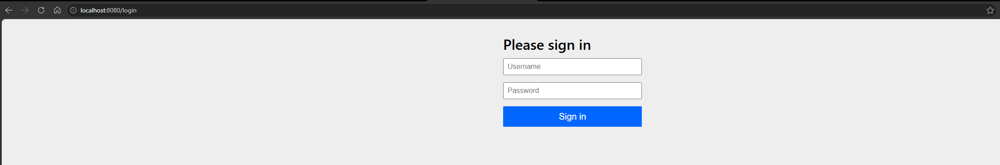
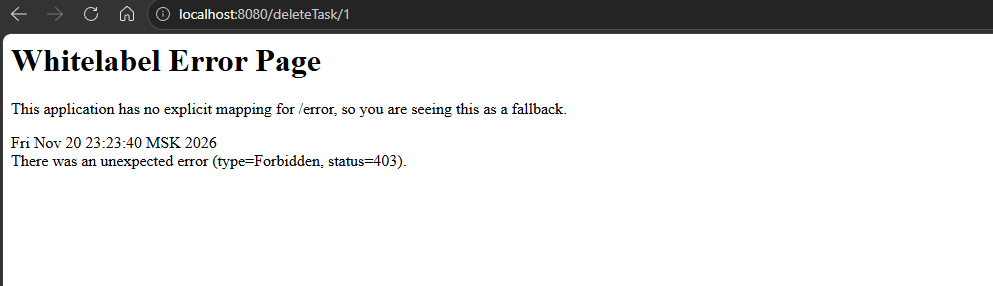

# Лабораторная работа №3. Spring Security

## Цель работы

Получить практические навыки работы со Spring Framework.

## Ход работы

Для выполнения лабораторной работы было использовано веб-приложение ToDo List из предыдущей лабораторной работы. Проект разработан на Java 21 с использованием Maven, Spring Boot 4.2.0, Spring MVC и Thymeleaf.

В файл pom.xml была добавлена зависимость Spring Security для реализации аутентификации и авторизации пользователей.

Создан класс SecurityConfig, в котором настроены пользователи с ролями USER и MODERATOR. Для хранения пользователей используется InMemoryUserDetailsManager, а для хеширования паролей - BCryptPasswordEncoder.

В классе TaskController с помощью аннотации @PreAuthorize реализовано разграничение прав доступа.

Пользователь USER может просматривать и добавлять задачи. Пользователь MODERATOR дополнительно может удалять задачи и изменять их статус выполнения.

В качестве дополнительного задания была добавлена роль ADMIN. Администратору предоставлены права на управление задачами, включая удаление с подтверждением, реализованным в лабораторной работе №2.

## Результаты проверки

После запуска приложения по адресу `http://localhost:8080` открывается страница авторизации Spring Security.

Была проверена работа пользователей с различными ролями.

При входе под USER доступны просмотр и добавление задач. При попытке удалить задачу или изменить её статус сервер возвращает ошибку 403 Forbidden.

При входе под MODERATOR успешно выполняются удаление задач и изменение их статуса с Pending на Completed.

Дополнительно была проверена работа пользователя ADMIN. Администратор может добавлять задачи, изменять их статус и удалять записи. При удалении отображается окно подтверждения. При выборе «Отмена» задача сохраняется, а при выборе OK - удаляется.

Все предусмотренные операции были успешно проверены.

## Вывод

В ходе лабораторной работы была реализована система аутентификации и авторизации пользователей с использованием Spring Security. Настроено разграничение прав доступа к операциям приложения ToDo List. Дополнительно добавлена роль ADMIN с возможностью использования функциональности предыдущей лабораторной работы. Работоспособность системы безопасности была проверена.
