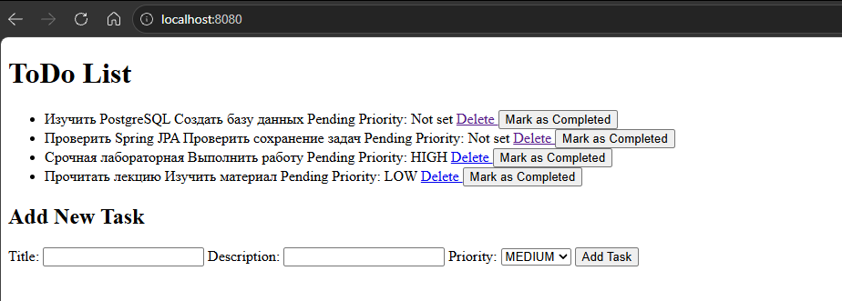
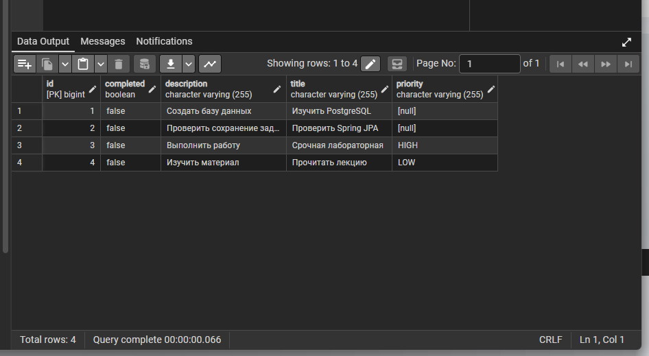

# Лабораторная работа №4. Взаимодействие Spring и PostgreSQL

## Цель работы

Получить практические навыки работы со Spring Framework и базой данных PostgreSQL.

## Ход работы

Для выполнения лабораторной работы было использовано веб-приложение ToDo List из предыдущей лабораторной работы. Проект разработан на Java 21 с использованием Maven, Spring Boot 4.2.0, Spring MVC, Spring Security и Thymeleaf.

Была установлена СУБД PostgreSQL 18 и создана база данных todo_db с помощью pgAdmin 4.

В файл pom.xml добавлены зависимости Spring Data JPA и PostgreSQL JDBC Driver. В application.properties настроено подключение к базе данных.

Класс Task был преобразован в JPA-сущность с использованием аннотаций @Entity, @Id и @GeneratedValue. Для хранения задач создана таблица tasks.

Класс TaskRepository был преобразован в интерфейс, наследующий JpaRepository. В TaskService реализована работа с базой данных через методы save(), findAll(), findById() и deleteById().

Сохранены функции добавления, просмотра, удаления задач и изменения их статуса, а также разграничение прав пользователей с помощью Spring Security.

В качестве дополнительного задания таблица tasks была расширена полем priority. Реализован выбор приоритета LOW, MEDIUM или HIGH при создании задачи.

## Результаты проверки

После запуска приложения было установлено успешное соединение с базой данных todo_db. Hibernate автоматически создал таблицу tasks.

В веб-приложении были добавлены задачи, которые успешно сохранились в PostgreSQL.

После перезапуска Spring Boot все записи остались в базе данных.

Дополнительно была проверена работа приоритетов задач. Созданы задачи с приоритетами HIGH и LOW. Значения успешно отображаются в приложении и сохраняются в PostgreSQL.

### Веб-интерфейс приложения

### Данные в PostgreSQL

Проверка таблицы через pgAdmin 4 подтвердила наличие полей id, title, description, completed и priority.

После повторного запуска приложения задачи и их приоритеты сохранились.

## Вывод

В ходе лабораторной работы было настроено взаимодействие Spring Boot с PostgreSQL с использованием Spring Data JPA и Hibernate. Реализовано постоянное хранение задач в базе данных. В качестве дополнительного задания добавлена возможность выбора и сохранения приоритета задачи. Работоспособность приложения была успешно проверена.
